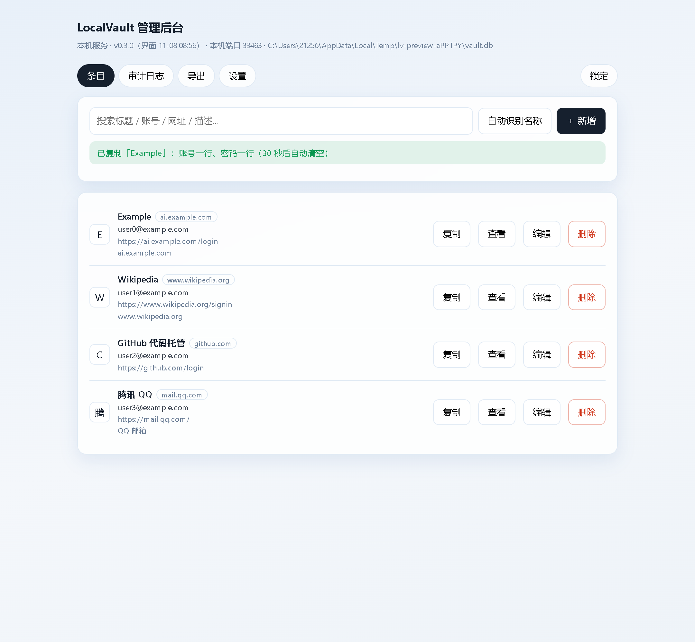
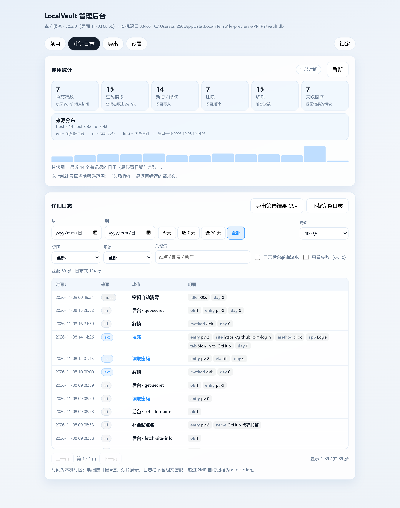

# LocalVault

[中文](README.md) | **English**

A password manager that keeps your passwords on your own machine.
Browser extension (Chrome / Edge) + a small local helper written in C#, talking over Native Messaging.
**No account. No server. No network requests. Nothing uploaded.**

There is also a **local management console** (opens in its own window, like a desktop app):
the full entry list, settings, export and a detailed audit log live there; the extension popup
shows only the 2 most recent entries.

## What it does

- **Detects login/signup forms automatically** — a small icon appears next to the password field;
  **fill happens only on click** (never autofill on page load, never auto-submit).
- **One-click copy**: username on one line, password on the next; the clipboard is cleared after 30 seconds.
- **Password generator**: on signup pages it generates a strong password that satisfies the site's own rules (length / maxlength / pattern).
- **Verification-code logins**: fills the phone/email only — the code is always yours to request and type.
- **Multiple accounts on one site**: asks which one instead of silently filling the first.
- **Windows Hello unlock** (hardware-backed with a TPM chip; software user+machine protection without one —
  copying the vault file to another PC won't unlock it).
- **Save prompt** after a successful login.
- **Local management console**: entry management, export, a detailed audit log
  (which client read a password, how many times fill was used, what happened to it).
- **One vault shared by both browsers**: install the extension in Chrome and Edge; concurrent writes merge automatically.

## Install (about 5 minutes)

1. **Get the code**: `git clone` this repo, or download a Release zip (comes with a built `ext/`).
2. **Install the helper**: double-click `installer\install.cmd`.
   It first **asks where to install** (press Enter for `%LOCALAPPDATA%\LocalVault`, or type e.g. `D:\LocalVault`).
   Everything lives in the directory you pick — the executable **and** the data
   (`<install dir>\data\`: vault, backups, audit log); no split between drives.
   **No .NET SDK, no admin rights, no network, no reboot.**
   For scripted installs: `-InstallDir D:\LocalVault -Silent`.

   > **TPM / Windows Hello**: no extra setup needed. The settings page **auto-detects** your machine.
   > Master-password unlock always remains available as a fallback.
3. **Load the extension**: open `edge://extensions` (or `chrome://extensions`) → enable **Developer mode** →
   **Load unpacked** → pick `app/dist/chrome-mv3` (`ext/` in the release zip).
   **Do not move or delete that folder afterwards**, or the extension will break.
4. **Create your vault**: click the extension icon → create vault → set a master password →
   **write the recovery key down on paper** (it is the only way back).
5. **Use it**: open any login page and click the small icon next to the password field.
6. **(Optional) open the local console**: double-click the desktop shortcut **LocalVault 管理后台**
   (or `vault-ui.cmd` in the install folder).

Something broken? Run `installer\diagnose.cmd` — it prints the host path, manifest, registry entries,
vault file and backups.

## The local management console

The console is not an extension page: the helper embeds an HTTP server bound only to `127.0.0.1`,
opened in its own window. **No extension needed, no network, no admin rights.**

| Tab | What is there |
|---|---|
| Entries | Full searchable list; site names/descriptions (auto-recognized); one-click copy (username + password on two lines), view, edit, delete |
| Audit log | Stat cards + per-day bar chart; a real data table with date/action/source/keyword filters, "failures only", sorting, paging, CSV export |
| Export | Encrypted backup (import on another PC with the same master password), plain JSON / CSV (delete after use) |
| Settings | Three encryption levels, machine info and diagnostics |

Stop the standalone console with `vault-ui.cmd -Stop` (the extension is unaffected).

## Where your data lives, and how safe it is

- The vault is **one encrypted file** (`vault.db`) in `data\` inside the install directory;
  Argon2id + AES-256-GCM, **each entry encrypted separately** — leaking one entry's ciphertext
  does not affect the others.
- The master password is never sent to any process and never written to disk; **no network at all**:
  the extension requests no network permission, the console listens on the local loopback only.
- No plaintext key in memory either: DPAPI memory encryption + locked pages +
  auto-wipe after 10 minutes idle + wiped after every use.
- Uninstall: `installer\uninstall.cmd` (keeps the vault by default; `-Purge` removes the data too).

## FAQ

**Why "load unpacked"?**
Until the extension is on a store, this is the only way that needs no signing.

**I forgot my master password.**
Only the recovery key from vault creation can reset it. That is why step 4 says to write it down.

**How do I move to a new computer?**
Console → Export → encrypted backup; on the new PC, install and use "import from backup" with the same master password.

**Firefox / Mac / Linux?**
Windows + Chrome/Edge only for now (the helper uses Windows DPAPI/TPM).

**MIT license** · [中文](README.md) · report vulnerabilities via [SECURITY.md](SECURITY.md)
