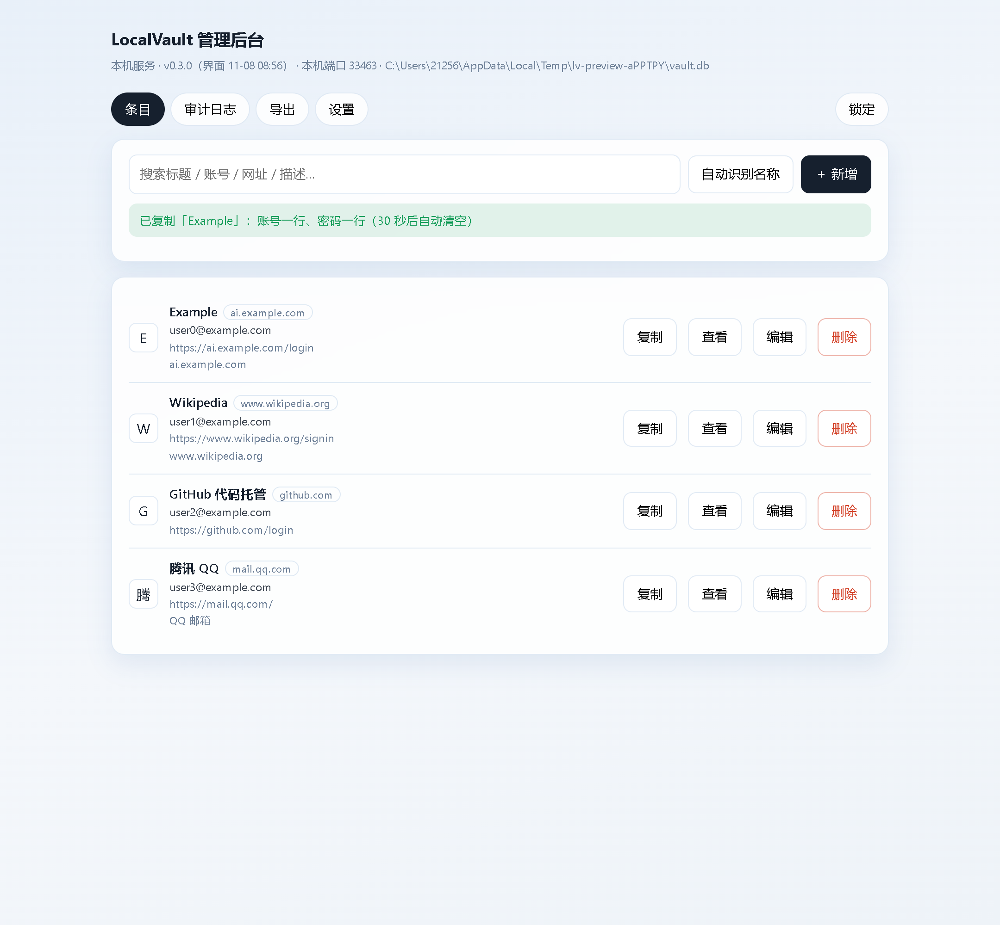
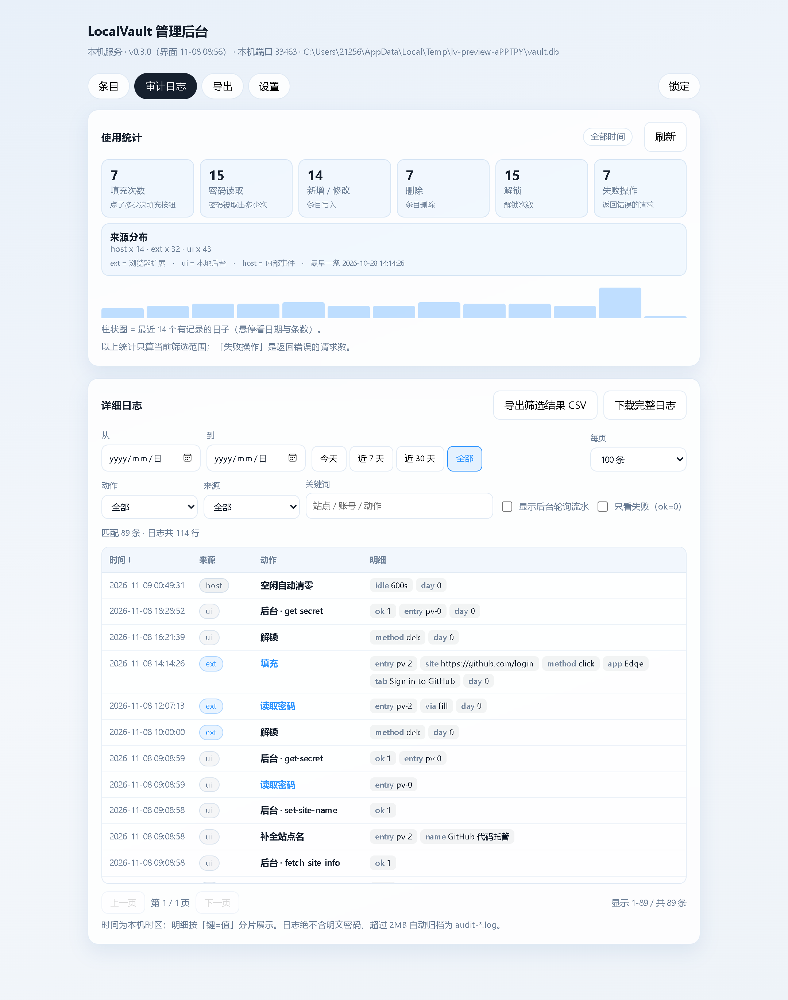

# LocalVault · 本地密码管理器

**中文** | [English](README.en.md)

密码只存在本机：浏览器扩展（Chrome / Edge）+ 一个 C# 本地小助手，两者之间走 Native Messaging。
**不联网、不注册账号、不上传保险库。**

另有一个**本地管理后台**（以独立窗口打开，像桌面程序）：全部条目、设置、导出、详细审计日志都在里面，
扩展弹窗只留最近 2 条。

## 它能做什么

- **自动识别登录/注册表单**，密码框旁出现小图标，**点一下才填**（绝不自动填充、绝不自动提交）
- **一键复制**：账号一行、密码一行，30 秒后自动清空剪贴板
- **密码生成器**：注册页直接生成符合站点规则（长度 / maxlength / pattern）的强密码
- **验证码登录**：自动填手机号/邮箱，验证码永远由你自己填
- **同站多账号**：弹出「选择要填充的账号」，不闷头填第一条
- **Windows Hello 解锁**：把钥匙交给一把「每次使用都要你确认」的系统密钥——开启和解锁都会弹 Windows 确认框，配了指纹/PIN 的机器要验一次；拷走文件在别的电脑解不开
- **保存浮窗**：登录成功后询问「保存到 LocalVault？」
- **本地管理后台**：条目管理、导出备份、详细审计日志（哪个程序读过密码、点过多少次填充、对密码做过什么）
- **双浏览器共用一个保险库**：Chrome 和 Edge 装同一个扩展即可，并发写入自动合并

## 快速开始（5 分钟）

1. **拿到代码**：`git clone` 本仓库，或下载 Release 压缩包（自带构建好的 `ext/`）
2. **装本地助手**：双击 `installer\install.cmd`
   —— 会先问你要装到哪个目录（**直接回车**用默认 `%LOCALAPPDATA%\LocalVault`，
   想放别的盘就输入如 `D:\LocalVault`）。**程序和数据都放在你选的目录里**：保险库、备份、审计日志
   都在它的 `data` 子目录，不会出现「程序在 D、数据在 C」的分裂。
   **全程不需要管理员权限、不需要联网、不需要重启、不需要 .NET SDK。**
   脚本化安装可加 `-InstallDir D:\LocalVault -Silent` 跳过询问。

   > **Windows Hello 解锁说明**：装好后无需任何额外配置——扩展设置页里的
   > 「用 Windows Hello 解锁」开关会**自动探测**本机能力。开启时会弹一次系统确认框（建密钥），
   > 之后每次用它解锁还会再确认一次；如果你的电脑不强制这个确认，程序会直接拒绝开启，
   > 而不是给一个「看起来有 Hello、其实没有」的开关。不开启也完全可以，主密码始终可用作回退。
3. **装扩展**：浏览器打开 `edge://extensions`（或 `chrome://extensions`）→ 开启「开发人员模式」
   → 「加载解压缩的扩展」→ 选 `app/dist/chrome-mv3`（用 Release 包则选 `ext/`）
   —— **加载后不要移动/删除这个目录**，否则扩展失效。
4. **建库**：点扩展图标 → 创建保险库 → 设主密码，**把恢复密钥抄到纸上**（丢了只能靠它）
5. **用起来**：打开任意登录页，密码框右侧出现小图标，点一下填入
6. **（可选）打开本地管理后台**：双击桌面「LocalVault 管理后台」，或安装目录里的 `vault-ui.cmd`

排查问题跑 `installer\diagnose.cmd`，它会把 host、注册表、保险库、备份的状态列出来。

## 本地管理后台

后台不是扩展页面：它是 host 进程内嵌的一个只绑 `127.0.0.1` 的本地服务，**不需要先开扩展、
不需要联网、不需要管理员权限**。

| 标签页 | 内容 |
|---|---|
| 条目 | 全库列表 + 搜索；站点名/解释（可自动识别）；一键「复制」账号+密码（两行）、查看、编辑、删除 |
| 审计日志 | 统计卡片 + 按天柱状图；正式数据表，支持日期/动作/来源/关键词筛选、「只看失败」、排序、分页、导出 CSV |
| 导出 | 加密备份（换电脑用同一主密码导入）、明文 JSON / CSV（用完请删除） |
| 设置 | 加密程度三档（标准 / 仅主密码 / 最严）、本机信息与诊断 |

关闭独立后台：`vault-ui.cmd -Stop`（不影响扩展）。

## 数据存在哪、安不安全

- 保险库是**一个加密文件**（`vault.db`）在安装目录的 `data\` 里；Argon2id + AES-256-GCM，
  每条条目单独加密——单条密文泄露不影响其他条目
- 主密码不发给任何进程、不落盘；**绝不联网**：扩展无网络权限，后台只监听本机回环
- 密码在内存里也不留明文：DPAPI 内存加密 + 锁页 + 空闲 10 分钟自动清零 + 用后即清
- 卸载：`installer\uninstall.cmd`（默认保留保险库；`-Purge` 连数据一起删）

## 常见问题

**为什么是「加载解压缩的扩展」？**
未上架应用商店前，这是唯一不需要签名的方式。

**忘了主密码怎么办？**
只能用创建保险库时的恢复密钥重设。这也是为什么第 4 步要你抄到纸上。

**换电脑怎么迁移？**
后台「导出 → 加密备份」，新电脑装好后「从备份导入」，用同一个主密码。

**开启 Windows Hello 会改掉我电脑的 PIN 吗？**
不会。开启时如果这台电脑还没设过 Windows Hello，系统会让你先设一个 PIN 或录入指纹；
这个 PIN 只属于这台电脑，不会同步，也不会影响你在其他电脑上的 PIN 和密码。
本程序只创建自己的一把密钥（名字以 `LocalVault-` 开头），不会修改任何系统账户凭据。

**开机时要求输入 PIN，和这个有关系吗？**
无关。开机前就要求输入的是 BitLocker 的预启动 PIN（在「管理 BitLocker」里单独设置），
和 Windows Hello 的登录 PIN 是两回事，本程序不会配置 BitLocker。忘了就用恢复密钥解锁：
<https://account.microsoft.com/devices/recoverykey>。

**支持 Firefox / Mac / Linux 吗？**
目前只支持 Windows + Chrome/Edge（本地助手用了 Windows 的 DPAPI/TPM）。

**MIT 许可** · [English](README.en.md) · 报告漏洞请走 [SECURITY.md](SECURITY.md)
